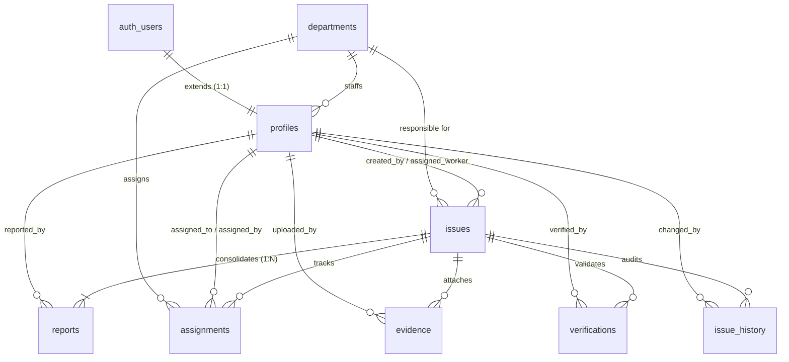

# Civion PostgreSQL Database & Supabase Architecture

> **Civion**: Crowdsourced Civic Issue Reporting and Resolution Platform  
> **Backend Architecture**: Supabase PostgreSQL with PostGIS Geospatial Engine, Automated Deduplication, and Strict Row Level Security (RLS).

---

## Table of Contents
1. [Entity-Relationship Summary](#1-entity-relationship-summary)
2. [Database Schema & Architecture](#2-database-schema--architecture)
3. [PostGIS & Geospatial Deduplication](#3-postgis--geospatial-deduplication)
4. [Master Issue / Duplicate Report Model](#4-master-issue--duplicate-report-model)
5. [Row Level Security (RLS)](#5-row-level-security-rls)
6. [Functions & Triggers Reference](#6-functions--triggers-reference)
7. [Important Demo Queries (SQL)](#7-important-demo-queries-sql)
8. [Next.js Integration Guide](#8-nextjs-integration-guide)
9. [AI Integration Bridge](#9-ai-integration-bridge)
10. [Setup & Migration Instructions](#10-setup--migration-instructions)

---

## 1. Entity-Relationship Summary

### Architecture Overview


### Table Relationships & Keys

| Table | Primary Key | Foreign Keys | Key Roles |
| :--- | :--- | :--- | :--- |
| **`departments`** | `id UUID` | *None* | Defines civic departments (Roads, Water, Waste, etc.) |
| **`profiles`** | `id UUID` | `id -> auth.users.id`<br>`department_id -> departments.id` | User profiles with role constraint (`citizen`, `authority`, `field_worker`, `admin`) |
| **`issues`** | `id UUID` | `department_id -> departments.id`<br>`assigned_worker_id -> profiles.id`<br>`created_by -> profiles.id` | The single actionable master issue (deduplicated) |
| **`reports`** | `id UUID` | `issue_id -> issues.id`<br>`reported_by -> profiles.id` | Individual citizen report submissions attached to a master issue |
| **`assignments`**| `id UUID` | `issue_id -> issues.id`<br>`department_id -> departments.id`<br>`worker_id -> profiles.id`<br>`assigned_by -> profiles.id` | Work order delegations to field workers |
| **`evidence`** | `id UUID` | `issue_id -> issues.id`<br>`uploaded_by -> profiles.id` | Before/after photographic evidence uploaded by field workers |
| **`verifications`**| `id UUID` | `issue_id -> issues.id`<br>`verified_by -> profiles.id` | Citizen review of resolution outcome (`approved` or `rejected`) |
| **`issue_history`**| `id UUID` | `issue_id -> issues.id`<br>`changed_by -> profiles.id` | Immutable chronological audit trail (WHO, WHAT, WHEN) |

---

## 2. Database Schema & Architecture

### Allowed Enumerations & Constraints
- **Profile Roles**: `'citizen'`, `'authority'`, `'field_worker'`, `'admin'`
- **Issue Categories**: `'pothole'`, `'garbage'`, `'broken_streetlight'`, `'water_leakage'`, `'drainage'`, `'road_damage'`, `'illegal_dumping'`, `'other'`
- **Issue Severity**: `'low'`, `'medium'`, `'high'`, `'critical'`
- **Issue Status**: `'open'`, `'assigned'`, `'in_progress'`, `'resolved'`, `'verified'`, `'closed'`, `'rejected'`
- **Assignment Status**: `'assigned'`, `'accepted'`, `'in_progress'`, `'completed'`, `'cancelled'`
- **Verification Status**: `'approved'`, `'rejected'`
- **Priority Score**: Integer between `0` and `100`

### Performance & Spatial Indexes
- **Spatial GiST Indexes**:
  - `idx_issues_location_gist` on `issues USING GIST (location)`
  - `idx_reports_location_gist` on `reports USING GIST (location)`
- **Filtering & Joining B-Tree Indexes**:
  - `idx_issues_status`, `idx_issues_category`, `idx_issues_priority_score`
  - `idx_issues_department_id`, `idx_issues_assigned_worker_id`, `idx_issues_created_at`
  - `idx_reports_issue_id`, `idx_reports_reported_by`
  - `idx_assignments_worker_id`, `idx_assignments_issue_id`, `idx_assignments_status`
  - `idx_evidence_issue_id`, `idx_verifications_issue_id`, `idx_issue_history_issue_id`

---

## 3. PostGIS & Geospatial Deduplication

PostGIS is enabled via `CREATE EXTENSION IF NOT EXISTS postgis;`.
Locations are stored using the standard:
```sql
GEOGRAPHY(Point, 4326)
```

### Proximity Stored Function: `get_nearby_open_issues`
Allows Next.js and AI services to search for active, unresolved issues within a radius (e.g., 100 meters) of coordinates:

```sql
SELECT * FROM public.get_nearby_open_issues(
    p_latitude => 12.9784,
    p_longitude => 77.6408,
    p_radius_meters => 150.0
);
```

### Automatic Coordinate Synchronization Trigger
Both `issues` and `reports` utilize the trigger `fn_sync_point_location`. If the application sends `latitude` and `longitude`, PostGIS automatically populates the `location` geography column:
```sql
location := ST_SetSRID(ST_MakePoint(longitude, latitude), 4326)::geography;
```

---

## 4. Master Issue / Duplicate Report Model

In traditional civic apps, every citizen report creates a disjointed ticket, flooding authorities with duplicate tasks.  
**Civion consolidates duplicate reports into one Master Issue while preserving individual citizen submissions:**

1. **First Citizen reports an issue**:
   - Master issue `CIV-1001` is created in `issues`.
   - Initial report is linked in `reports (issue_id = CIV-1001)`.
   - `support_count = 1`.
2. **Subsequent Citizens report nearby or identical issues**:
   - Instead of creating a new issue, `reports` record is created with `issue_id = CIV-1001`.
   - The database trigger `trg_reports_sync_support_count` automatically recalculates `issues.support_count`.
   - Each citizen retains their own timestamp, photo evidence, and description.
   - The master issue priority increases as citizen support grows.

---

## 5. Row Level Security (RLS)

All tables enforce Row Level Security using `get_auth_role()` and `get_auth_department_id()`.

| Table | Citizen | Authority | Field Worker | Admin |
| :--- | :--- | :--- | :--- | :--- |
| **`departments`** | Read Only | Read Only | Read Only | Full CRUD |
| **`profiles`** | Read all, update own | Read all, update own | Read all, update own | Full CRUD |
| **`issues`** | Read all, insert new | Read all, update dept issues | Read assigned, update status | Full CRUD |
| **`reports`** | Insert own, view reports | View all reports | View assigned issue reports | Full CRUD |
| **`assignments`** | Read | Create & manage | Read assigned, update status | Full CRUD |
| **`evidence`** | Read all | Read all, upload | Read all, upload for assigned | Full CRUD |
| **`verifications`**| Read all, submit review | Read all | Read all | Full CRUD |
| **`issue_history`**| Read all | Read all | Read all | Full CRUD |

---

## 6. Functions & Triggers Reference

1. **`fn_generate_issue_code()`**: Automatically assigns `CIV-1001`, `CIV-1002`, etc., using sequence `issue_code_seq`.
2. **`fn_sync_point_location()`**: Automatically synchronizes `(latitude, longitude)` with PostGIS `location`.
3. **`fn_sync_support_count()`**: Automatically updates `issues.support_count` when reports are linked or deleted.
4. **`fn_log_issue_status_change()`**: Automatically records status transitions in `issue_history` and updates `resolved_at` or `closed_at`.
5. **`create_issue_with_report(...)`**: Atomic transaction creating an issue and its first report.
6. **`link_duplicate_report(...)`**: Links a duplicate report to an existing master issue and increments priority.
7. **`assign_issue_to_worker(...)`**: Assigns issue to a field worker and records work order.
8. **`resolve_issue_with_evidence(...)`**: Stores resolution evidence, marks assignment completed, and sets issue to `resolved`.
9. **`submit_issue_verification(...)`**: Handles citizen verification. If `rejected`, reverts issue to `in_progress` rather than deleting it.

---

## 7. Important Demo Queries (SQL)

### 1. Get all open issues ordered by priority
```sql
SELECT 
    issue_code,
    title,
    category,
    severity,
    priority_score,
    support_count,
    status,
    created_at
FROM public.issues
WHERE status IN ('open', 'assigned', 'in_progress')
ORDER BY priority_score DESC, support_count DESC;
```

### 2. Get issues for a department
```sql
SELECT 
    i.issue_code,
    i.title,
    i.category,
    i.status,
    i.priority_score,
    d.name AS department_name,
    p.full_name AS assigned_worker
FROM public.issues i
JOIN public.departments d ON i.department_id = d.id
LEFT JOIN public.profiles p ON i.assigned_worker_id = p.id
WHERE d.name = 'Roads & Highways'
ORDER BY i.priority_score DESC;
```

### 3. Get assignments for a field worker
```sql
SELECT 
    a.id AS assignment_id,
    i.issue_code,
    i.title,
    i.category,
    a.status AS assignment_status,
    a.assigned_at,
    a.notes
FROM public.assignments a
JOIN public.issues i ON a.issue_id = i.id
WHERE a.worker_id = '44444444-4444-4444-4444-444444444401' -- Raju K
ORDER BY a.assigned_at DESC;
```

### 4. Get all reports belonging to a master issue (CIV-1001)
```sql
SELECT 
    i.issue_code,
    r.id AS report_id,
    p.full_name AS citizen_name,
    r.description,
    r.image_url,
    r.created_at
FROM public.reports r
JOIN public.issues i ON r.issue_id = i.id
JOIN public.profiles p ON r.reported_by = p.id
WHERE i.issue_code = 'CIV-1001'
ORDER BY r.created_at ASC;
```

### 5. Get nearby unresolved issues (within 100 meters of Indiranagar)
```sql
SELECT * FROM public.get_nearby_open_issues(
    p_latitude => 12.9784,
    p_longitude => 77.6408,
    p_radius_meters => 150.0
);
```

### 6. Get issue history (audit trail for CIV-1001)
```sql
SELECT 
    h.created_at,
    h.action,
    h.old_status,
    h.new_status,
    h.description,
    COALESCE(p.full_name, 'System') AS changed_by_user
FROM public.issue_history h
JOIN public.issues i ON h.issue_id = i.id
LEFT JOIN public.profiles p ON h.changed_by = p.id
WHERE i.issue_code = 'CIV-1001'
ORDER BY h.created_at ASC;
```

### 7. Get resolution evidence
```sql
SELECT 
    i.issue_code,
    i.title,
    e.image_url AS resolution_photo,
    e.description AS worker_comment,
    p.full_name AS uploaded_by,
    e.created_at
FROM public.evidence e
JOIN public.issues i ON e.issue_id = i.id
JOIN public.profiles p ON e.uploaded_by = p.id
WHERE i.status = 'resolved' OR i.status = 'verified';
```

### 8. Get verification status
```sql
SELECT 
    i.issue_code,
    i.title,
    v.status AS verification_result,
    v.comment AS citizen_feedback,
    p.full_name AS verified_by,
    v.created_at
FROM public.verifications v
JOIN public.issues i ON v.issue_id = i.id
JOIN public.profiles p ON v.verified_by = p.id
ORDER BY v.created_at DESC;
```

---

## 8. Next.js Integration Guide

### 8.1 Initialize Supabase Client
Install dependencies:
```bash
npm install @supabase/supabase-js
```

Configure `src/lib/supabase.ts`:
```typescript
import { createClient } from '@supabase/supabase-js';

const supabaseUrl = process.env.NEXT_PUBLIC_SUPABASE_URL!;
const supabaseAnonKey = process.env.NEXT_PUBLIC_SUPABASE_ANON_KEY!;

export const supabase = createClient(supabaseUrl, supabaseAnonKey);
```

### 8.2 Common Client Queries

#### 1. Retrieve Public Issues (with support count & department)
```typescript
const { data: issues, error } = await supabase
  .from('issues')
  .select(`
    id,
    issue_code,
    title,
    category,
    severity,
    status,
    priority_score,
    support_count,
    latitude,
    longitude,
    departments ( name )
  `)
  .order('priority_score', { ascending: false });
```

#### 2. Check for Nearby Unresolved Issues (Proximity / Duplicate Check)
```typescript
const { data: nearbyIssues, error } = await supabase.rpc('get_nearby_open_issues', {
  p_latitude: 12.9784,
  p_longitude: 77.6408,
  p_radius_meters: 100.0,
});
```

#### 3. Create a Report (New Master Issue)
```typescript
const { data, error } = await supabase.rpc('create_issue_with_report', {
  p_title: 'Pothole on 100ft road',
  p_description: 'Deep rim-bending crater near metro',
  p_category: 'pothole',
  p_latitude: 12.9784,
  p_longitude: 77.6408,
  p_image_url: 'https://...',
  p_severity: 'high',
  p_priority_score: 75,
});
```

#### 4. Link a Duplicate Report to an Existing Issue
```typescript
const { data, error } = await supabase.rpc('link_duplicate_report', {
  p_issue_id: '66666666-6666-6666-6666-666666666601',
  p_description: 'Also saw this pothole today, saw a bike swerve',
  p_image_url: 'https://...',
  p_latitude: 12.9785,
  p_longitude: 77.6409,
});
```

#### 5. Retrieve a Citizen's Submitted Reports
```typescript
const { data: userReports, error } = await supabase
  .from('reports')
  .select(`
    id,
    description,
    image_url,
    created_at,
    issues (
      issue_code,
      title,
      status,
      category
    )
  `)
  .eq('reported_by', userId)
  .order('created_at', { ascending: false });
```

#### 6. Field Worker: Retrieve Assigned Work Orders
```typescript
const { data: myTasks, error } = await supabase
  .from('assignments')
  .select(`
    id,
    status,
    notes,
    assigned_at,
    issues (
      id,
      issue_code,
      title,
      description,
      category,
      severity,
      latitude,
      longitude
    )
  `)
  .eq('worker_id', workerId)
  .in('status', ['assigned', 'in_progress']);
```

#### 7. Field Worker: Upload Resolution Evidence & Mark Resolved
```typescript
const { data, error } = await supabase.rpc('resolve_issue_with_evidence', {
  p_issue_id: issueId,
  p_image_url: uploadedEvidenceUrl,
  p_description: 'Asphalt patched and roller compacted.',
});
```

#### 8. Citizen: Submit Verification
```typescript
const { data, error } = await supabase.rpc('submit_issue_verification', {
  p_issue_id: issueId,
  p_status: 'approved', // or 'rejected'
  p_comment: 'Pothole is cleanly filled. Road is smooth now.',
});
```

---

## 9. AI Integration Bridge

AI models run outside the database (in Next.js Edge functions or Python workers). The AI pipeline should interact with the database as follows:

```
Citizen Photo + Text
      │
      ▼
AI Classifier (Vision + LLM)
      │
      ├─► Suggested Category: "pothole"
      ├─► Estimated Severity: "critical"
      └─► Initial Priority: 85
      │
      ▼
Database RPC: get_nearby_open_issues(lat, lon, 100)
      │
   ┌──┴─────────────────────────┐
   │ Found matches?             │
   ▼ YES                        ▼ NO
Suggest Master CIV-1001     Create New Master Issue
(Call link_duplicate_report) (Call create_issue_with_report)
```

**Guardrails & Validation:**
- Any values passed from the AI model (such as category or severity) must respect database constraints (`CHECK (category IN (...))`).
- If the AI returns an unrecognized category, normalize it to `'other'` before inserting.

---

## 10. Setup & Migration Instructions

### Option A: Supabase Dashboard SQL Editor
1. Open your Supabase project dashboard.
2. Go to **SQL Editor**.
3. Run the scripts in the following order:
   1. `database/schema.sql` (Creates PostGIS, tables, indexes, triggers, and RLS)
   2. `database/functions.sql` (Creates RPCs and stored procedures)
   3. `database/seed.sql` (Loads 6 departments, 11 users, 10 issues, and demo reports)

### Option B: Supabase CLI (Local Dev)
```bash
# Apply schema and functions
supabase db push
# Or run direct psql
psql $DATABASE_URL -f database/schema.sql
psql $DATABASE_URL -f database/functions.sql
psql $DATABASE_URL -f database/seed.sql
```
